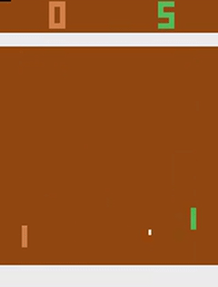
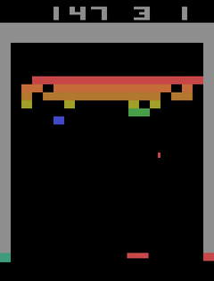

# Atari RL agent

Reinforcement learning based agents to playing Atari games.

## Agents

- Deep Q-network(DQN)
    - Double DQN
    - Prioritized Replay
    - Dueiling network

- Asynchronous Advantage Actor-Critic(A3C)
    - Multiprocess support
    - Multiprocess Cuda support
    - LSTM based model
    - Generalized Advantage Estimate (GAE)
    - Frame stacking based model

## Game Play

### DQN




### A3C


## Supported Environment

- [x] BreakoutDeterministic-v4
- [x] PongDeterministic-v4
- [x] KungFuMasterDeterministic-v4
- [x] BoxingDeterministic-v4
- [ ] SapecInvadersDeterministic-v4

## TODO

- [x] DQN
- [x] TensorBoard support
- [x] Double DQN
- [x] Prioritized replay
- [x] Dueling network
- [X] Train model for Pong
- [x] Achive 300+ score on breakout
- [x] A3C Agent for KungFuMasterDeterministic-v4
- [x] A3C Agent for BoxingDeterministic-v4
- [x] Parallel processing for A3C
- [x] LSTM layer for A3C to replace frame stacking

## Video face indexing and human tracking tools

Two standalone utilities under `tools/` help catalog faces in a video and build
person-level visibility segments for downstream processing.

### 1. Face indexer

The face indexer extracts representative face crops, assigns consistent
identities using InsightFace embeddings, and records visibility segments where a
face is present in at least 80% of the frames within a contiguous stretch.

```
python tools/face_indexer.py \
  --video path/to/video.mp4 \
  --output-json faces.json \
  --collage faces.png \
  --similarity-threshold 0.4 \
  --max-gap 10 \
  --min-visible-ratio 0.8
```

Output JSON structure (excerpt):

```
{
  "video_path": "path/to/video.mp4",
  "collage": "/abs/path/faces.png",
  "people": [
    {
      "face_id": 1,
      "selected": true,
      "embedding": [...],
      "segments": [
        {"start_frame": 150, "end_frame": 2300, "visibility_ratio": 0.93}
      ]
    }
  ]
}
```

### 2. Human tracker

The tracker consumes the JSON from the face indexer (using only entries marked
`selected`) and produces per-person segments after tracking and re-identifying
people through occlusions via YOLOv8 + DeepSORT.

```
python tools/human_tracker.py \
  --video path/to/video.mp4 \
  --face-json faces.json \
  --output-json tracks.json \
  --detector yolov8x.pt \
  --tracking-max-age 30 \
  --embedding-threshold 0.4 \
  --max-gap 15 \
  --min-visible-ratio 0.8
```

Result JSON example:

```
{
  "video_path": "path/to/video.mp4",
  "people": [
    {
      "face_id": 1,
      "segments": [
        {"start_frame": 150, "end_frame": 2300, "visibility_ratio": 0.91},
        {"start_frame": 5000, "end_frame": 8600, "visibility_ratio": 0.88}
      ]
    }
  ]
}
```

## License

The Apache-2.0 License. Please see the [license file](LICENSE) for more information.

## References

- https://github.com/yandexdataschool/Practical_RL
- https://github.com/openai/baselines/blob/master/baselines/deepq/replay_buffer.py
- https://towardsdatascience.com/tutorial-double-deep-q-learning-with-dueling-network-architectures-4c1b3fb7f756
- https://pytorch.org/docs/stable/notes/multiprocessing.html
- https://github.com/ikostrikov/pytorch-a3c
- https://arxiv.org/pdf/1506.02438.pdf
- https://arxiv.org/abs/1602.01783
